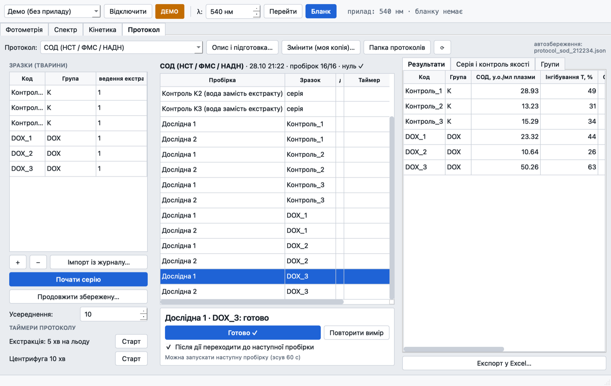
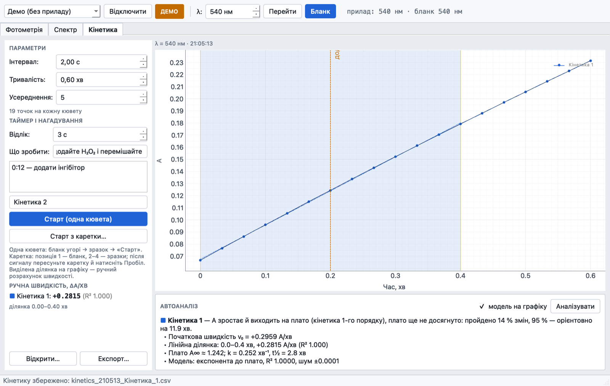
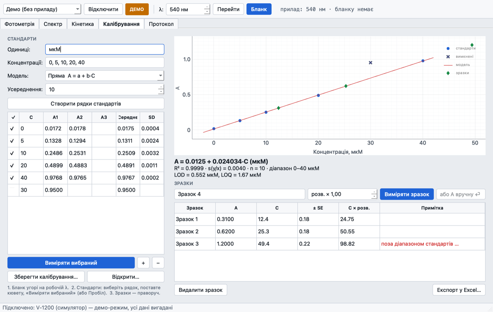
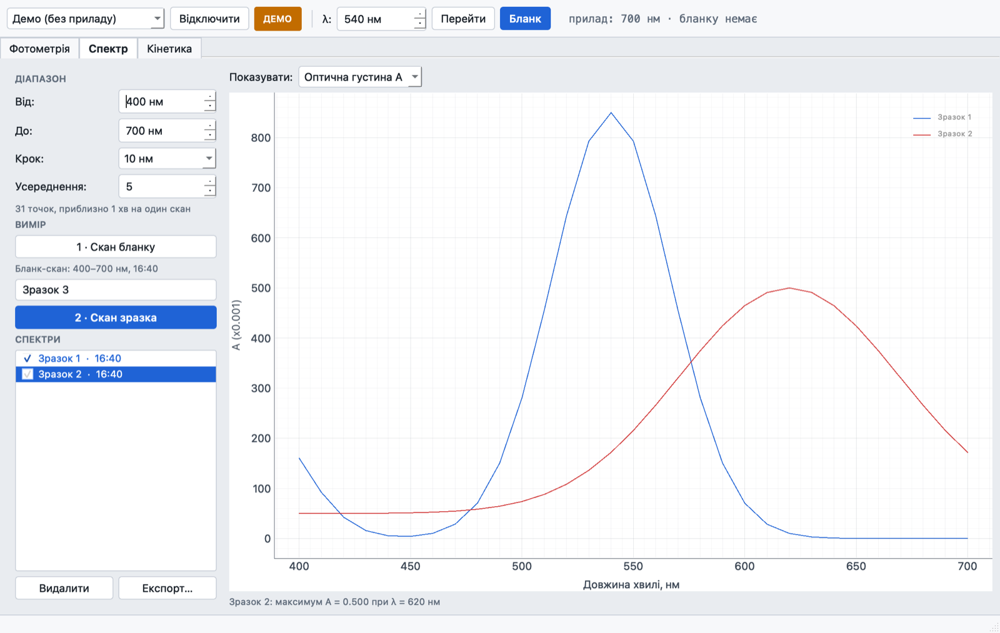

# SpecRec

**Control of the Mapada V-1200 (ЭКРОС ПЭ-5400В) visible spectrophotometer over USB:
photometry, spectrum scans, kinetics.** Ukrainian interface, portable, macOS / Windows / Linux.



The vendor software is Windows-only and copy-protected. SpecRec talks to the instrument
directly. The protocol was worked out by experiment and is described in
[docs/PROTOCOL.md](docs/PROTOCOL.md).

## Features
- **Photometry**: A and %T at a chosen wavelength against a blank. A results table, export to Excel/CSV.
- **Spectrum**: blank scan, then sample scans over any part of 325–1000 nm (step 1–20 nm).
  Spectra are overlaid, with the peak shown and the cursor showing values.
- **Kinetics**: A(t) at a fixed wavelength, every 1 s (practically continuous) to every hour.
  It works with one cuvette or several in the carriage: every cycle the program beeps and asks
  for the next position, and you confirm with Space. The rate ΔA/min (with R²) is computed
  for every sample over a region you drag on the plot. Saved files can be opened again
  (File → Open kinetics…) to analyse them later without the instrument.
- **Series with the multi-cell carriage**: the blank goes in position 1, samples in positions 2–4.
  The carriage is moved by hand: the program beeps and says which position to put in the beam.
  Works for photometry and for spectra (one blank scan, then a scan of each position).
- **Kinetics analysis and timers**: automatic curve type (straight line, plateau, S-curve / lag phase),
  initial rate, linear range, plateau and t½; a countdown before the start, reminders, markers
  and notifications.
- **Calibration**: standards (measured or typed in, replicates, outliers switched off), a line,
  a line through zero or a quadratic curve; equation, R², LOD and LOQ; concentrations of samples with
  ± SE and a range check; save, load, Excel.
- **Protocols**: the program guides a whole series step by step, tube by tube, with a timer for each tube.
  It reads at several wavelengths at once, computes results with quality flags and
  group statistics (Welch). It imports animals from the Excel journal, saves the series
  automatically so it can be continued later, and exports to Excel. Built-in: MDA, catalase, SOD,
  SH groups + haemolysis, protein by Bradford and by Lowry. You can write your own protocols in JSON (see [docs/PROTOCOLS.md](docs/PROTOCOLS.md)).
- **Every result is saved at once** to `SpecRec_data/<date>/` (CSV): `photometry.csv`,
  `scan_*.csv`, `kinetics_*.csv`.
- **Demo mode** with a virtual instrument (samples to choose "in the cuvette"), for practice
  and for testing without the instrument.
- Light and dark themes.

## Screenshots
| Kinetics with automatic analysis | Calibration curve | Spectra |
|---|---|---|
|  |  |  |

## Running
| System | Build | Run |
|---|---|---|
| macOS | `python build_app.py` | `SpecRec.app` (first time: right-click → Open, the app is not notarised) |
| Linux x86_64 | `bash docker/build-linux.sh` (Docker, Ubuntu 22.04) | `./SpecRec` in the unpacked folder |
| Windows | GitHub Actions (`.github/workflows/build.yml`) | `SpecRec.exe` |

A `portable.txt` next to the program keeps the data in `SpecRec_data/` beside it.

Linux: allow access to the USB port once with `sudo usermod -aG dialout $USER`, then log
out and back in.

From source:
```bash
conda create -n specrec python=3.12 && conda activate specrec
pip install -r requirements.txt
python -m specrec                 # start (connects to the instrument automatically)
python -m specrec --demo          # virtual instrument
python -m pytest -q               # tests
python build_app.py               # portable build for this OS → dist/
```

## Connecting
The program finds the instrument by itself. It looks at the USB serial ports (Silicon Labs CP210x
first), asks each one, and connects to the one that answers like a V-1200. The port is
remembered. It keeps watching the USB: plug the instrument in or switch it on, and SpecRec
connects within a few seconds; pull the cable, and it shows "disconnected" and reconnects
when the cable is back. After a manual "Disconnect" it does not reconnect on its own.
*Прилад → Підключення…* lists the ports, checks one, and switches auto-connect on or off.

## Notes
- macOS needs no driver. On Windows, install the Silicon Labs CP210x driver if no COM port appears.
- A blank is valid only for its wavelength. After changing the wavelength, blank again.
- "Disconnect" (or closing the program) sends `QU` to the instrument.
